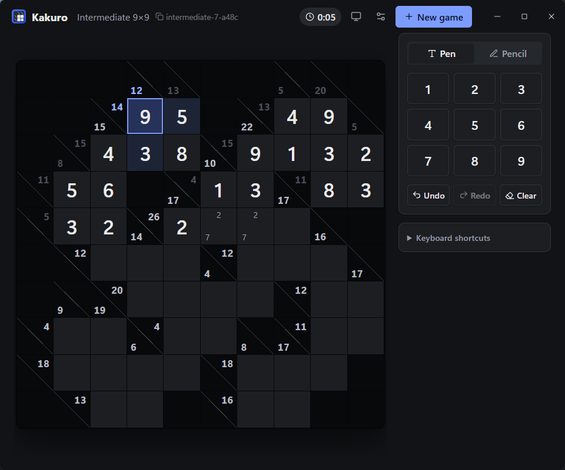

# Kakuro

Desktop app that generates uniquely solvable Kakuro puzzles and lets you play them. The puzzle model, generator, solver and game state live in Rust (`crates/kakuro-core`); a Tauri 2 shell (`src-tauri`) exposes them over typed IPC (tauri-specta) to a SvelteKit 3 / Svelte 5 frontend (`src`) that only renders. Progress is auto-saved after every change to `game.json` in the app data directory (`%APPDATA%\dev.kakuro.app` on Windows) and restored on launch.



Sizes (chosen from the **New game** dialog): Beginner 6×6, Intermediate 9×9, Expert 12×12, or any custom size from 4×4 to 15×15 (playable cells, excluding the clue row/column).

To play the same puzzle as someone else, share its **puzzle code** (e.g. `expert-2874619203-a7f3`: size, seed, and a 4-digit check). Click the code next to the size in the header, or **Copy code** on the solved card, to copy it; paste it into **Puzzle code** in the **New game** dialog and press **Open** to start that puzzle. Generation is deterministic, so the code regenerates the identical grid; the check digits catch typos and codes from an app version whose generator produces a different grid.

## Download

Portable builds are attached to each release on the [Releases page](https://github.com/Alintya/kakuro-game-rs/releases); nothing is installed.

- **Windows x64**: `kakuro-v<version>-windows-x64.zip`. Unzip and run `kakuro.exe`. The app is unsigned, so SmartScreen may show "Windows protected your PC" on the first launch: choose **More info** → **Run anyway**. Needs the WebView2 Runtime, preinstalled on Windows 10 (1803+) and 11; otherwise install the [Evergreen Bootstrapper](https://developer.microsoft.com/en-us/microsoft-edge/webview2/#download-section).
- **Linux x64**: `kakuro-v<version>-linux-x64.AppImage`. `chmod +x` it and run it. Needs webkit2gtk 4.1 (Ubuntu 22.04+, Fedora 36+, or equivalent).
- **macOS (universal)**: `kakuro-v<version>-macos-universal.zip`. Unzip and move `Kakuro.app` anywhere. The app is unsigned: before the first launch run `xattr -dr com.apple.quarantine Kakuro.app` (or, after the first blocked launch, open System Settings → Privacy & Security and choose **Open Anyway**).

The app is developed and tested on Windows. The Linux and macOS builds come from CI and are untested; bug reports are welcome.

## Controls

| Input | Action |
| --- | --- |
| Click a white cell | Select it |
| Arrow keys | Move to the next white cell |
| `1`–`9` | Enter digit (pencil mark when pencil mode is on) |
| `Shift` + `1`–`9` | Toggle pencil mark, regardless of mode |
| `0`, `Backspace`, `Delete` | Clear the cell (digit and pencil marks) |
| `Space` | Toggle pencil mode |
| `Escape` | Deselect |
| `Ctrl` + `Z` | Undo |
| `Ctrl` + `Y`, `Ctrl` + `Shift` + `Z` | Redo |
| `Ctrl` + `N` | New game |

Conflicting cells (repeated digit in a run, partial sum over the clue, complete run with the wrong sum) are highlighted live; the puzzle is marked solved once every cell is filled without conflicts. Selecting a cell highlights its runs and their clues; clues of correctly completed runs fade out.

The side panel holds the pen/pencil switch, a digit pad and undo/redo/clear. Solving aids are off by default and can be turned on individually in **Settings** (header settings button): a **Combinations** panel listing the digit sets that fit the selected cell's runs (sets ruled out by entered digits are struck through), and dimming of digit pad keys that cannot go in the selected cell. These choices and the theme (System/Light/Dark, header button) are remembered in the webview's `localStorage`.

Undo history and play time are saved with the game. The clock stops when the puzzle is solved and, unless **Pause when minimized** is turned off in Settings, while the window is minimized or hidden; an unfocused but visible window keeps it running.

On Windows the app draws its own title bar (`src-tauri/tauri.windows.conf.json` turns off native decorations): drag the header to move the window, double-click it to maximize, and use the minimize/maximize/close buttons at its right edge. Other platforms keep the native title bar.

## Development

Prerequisites:

- Rust 1.97 or newer via [rustup](https://rustup.rs) (`rust-toolchain.toml` selects stable with rustfmt and clippy).
- [Bun](https://bun.sh) 1.4.3 (`packageManager` in `package.json`).
- Tauri's platform dependencies ([details](https://v2.tauri.app/start/prerequisites/)):
  - Windows: Microsoft C++ Build Tools ("Desktop development with C++") and the WebView2 Runtime.
  - Linux (Debian/Ubuntu): `sudo apt install libwebkit2gtk-4.1-dev build-essential curl wget file libxdo-dev libssl-dev libayatana-appindicator3-dev librsvg2-dev`
  - macOS: `xcode-select --install`

Node.js is not required: the JS tooling (Vite, SvelteKit, svelte-check, Tauri CLI) runs on the Bun runtime via `bun --bun` in the `package.json` scripts, so use the scripts rather than invoking the tools directly. `bun run check` type-checks with `svelte-check` and TypeScript 6.

```sh
bun install
bun run tauri dev        # run the app (regenerates src/lib/ipc/bindings.ts)
bun run tauri build      # release build + installers
cargo test --workspace   # core tests
bun run check && bun run lint
cargo run -p kakuro -- --export-bindings                   # regenerate IPC bindings only
cargo run -p kakuro-core --example print -- expert [seed]  # print a generated puzzle + solution
bun run icons           # regenerate src-tauri/icons from app-icon.svg / app-icon-small.svg
```

## Releasing

1. Bump the version in `Cargo.toml` (`[workspace.package]`), `package.json` and `src-tauri/tauri.conf.json`, and add a `CHANGELOG.md` entry.
2. `git tag v<version> && git push origin v<version>`

The `Release` workflow checks that all three versions match the tag, builds the portable Windows, Linux and macOS artifacts listed under [Download](#download), and publishes them as a GitHub Release.

## Contributing

Before opening a pull request, run the same checks as CI:

```sh
bun run check && bun run lint
cargo fmt --all --check
cargo clippy --workspace --all-targets -- -D warnings
cargo test --workspace
```

## License

Licensed under either of [Apache License, Version 2.0](LICENSE-APACHE) or [MIT license](LICENSE-MIT) at your option.

Unless you explicitly state otherwise, any contribution intentionally submitted for inclusion in the work by you, as defined in the Apache-2.0 license, shall be dual licensed as above, without any additional terms or conditions.
